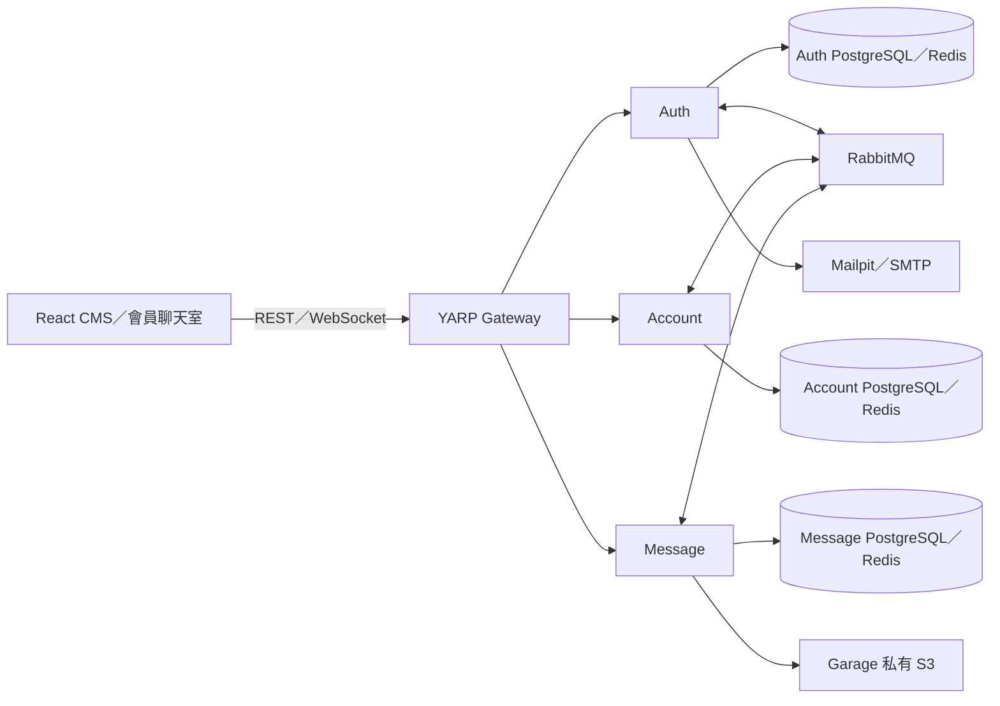

# MicroserviceStarter · Relay

.NET 10 微服務專案，附繁體中文 React 管理後台與會員聊天室。三個業務服務各有獨立 PostgreSQL Server／Redis，使用 RabbitMQ 同步資料，透過 YARP 提供統一 REST／WebSocket 入口。

## 啟動

需要 Docker Desktop／Docker Engine（啟用 BuildKit）、Docker Compose v2、Python 3.8 以上與 OpenSSL。完整應用由容器建置，主機不必安裝 .NET SDK。

```sh
./scripts/init.sh
docker compose up -d --build
```

初始化會產生 `.env`、3072-bit RSA 金鑰與 Garage 設定；再次執行不會覆寫憑證。首次建置須下載依賴，Migration 完成後才啟動服務。

| 入口 | 網址 |
|---|---|
| 會員聊天室 | http://localhost:8080/chat |
| CMS | http://localhost:8080/admin |
| Swagger 文件切換 | http://localhost:8080/docs |
| 測試信箱 | http://localhost:8025 |
| RabbitMQ 管理介面 | http://localhost:15672 |

初始管理員使用 `.env` 中的 `BOOTSTRAP_EMAIL`／`BOOTSTRAP_PASSWORD`；一般會員從網頁註冊，至 Mailpit 開啟驗證信。**沒有寫死的正式密碼。** 資料服務及 S3 API 不公開至主機。

## 服務與資料權責

| 服務 | PostgreSQL 資料 | Redis 用途 |
|---|---|---|
| Auth | 身分、密碼雜湊、角色、安全版本、登入 Session、驗證連結、加密郵件工作、稽核 | 登入／郵件限流、失敗計數、僅保存已撤銷 Session 的負向快取 |
| Account | 會員公開資料、投影版本、稽核 | 個人資料快取，損毀或故障時回源 PostgreSQL |
| Message | 一對一／群組、成員與權限、訊息序號、已讀、附件中繼資料、稽核 | 在線狀態、連線索引、SignalR backplane |

每個服務採 Domain／Application／Infrastructure／API 四層；禁止共用 DbContext、業務 Entity 或跨庫 JOIN。Gateway 與 React 網站不設資料庫。



詳見 [架構決策](docs/architecture.md)、[API 與錯誤規範](docs/api.md) 及 [維運與故障處理](docs/operations.md)。

可持續更新的 [Agent Living Document](docs/living/README.md) 提供十份 Markdown-in-SVG 圖頁，包含 UML 分層、資料模型、實體外鍵與邏輯參照、事件同步、撤銷及聊天時序；每份 SVG 內嵌權威 Markdown 與程式來源雜湊，CI 會檢查文件是否隨實作更新。

## 驗收與覆蓋率

測試使用獨立 `microservice-starter-tests` Compose 專案，Gateway／Mailpit 分別為 `18080`／`18025`。後端與前端各自要求 **行覆蓋率 ≥95%、分支覆蓋率 ≥90%**；不達標即失敗。後端包含 Gateway、共用程式及三個服務的全部自寫程式，僅排除 Migration／編譯器產生程式；前端僅排除測試與產生的 API 型別。

```sh
# 主機已有 .NET 10 SDK 與 Node 24.22.2 以上
./scripts/test.sh
./scripts/test-e2e.sh

# 使用容器執行後端、前端與瀏覽器測試
DOCKER_TESTS=1 ./scripts/test.sh
DOCKER_TESTS=1 ./scripts/test-e2e.sh
```

測試涵蓋註冊／驗證／密碼重設、Refresh Token 重用、跨帳號越權、最後管理員保護、並行註冊／訊息、已讀單調性、群組擁有權、20 MiB 與五個附件邊界、圖片偽造／解壓縮尺寸、S3 與快取故障、事件去重／亂序／死信、SMTP、WebSocket 推送／撤銷及瀏覽器重連。

結果位於 `artifacts/backend`、`src/Web/coverage`、`artifacts/playwright`。瀏覽器失敗時保留畫面與 trace；僅使用隔離測試帳號，CI 診斷檔保存三天。GitHub Actions 同時檢查格式、弱點、API 合約一致性及容器建置。

## 開發與文件產生

```sh
dotnet build MicroserviceStarter.slnx
dotnet format MicroserviceStarter.slnx --verify-no-changes
cd src/Web
npm ci
npm run dev
```

Vite 開發伺服器將 `/api` 與 `/hubs` 代理到本機 Gateway。OpenAPI 由實際 API 型別、驗證屬性及端點中繼資料自動產生，並附 Bearer 與 Problem Details 範例。

```sh
# 從專案根目錄，服務啟動後匯出並更新前端合約
node scripts/export-openapi.mjs
cd src/Web && npm run generate:api && npm run build
```

## 第一版部署邊界

Compose 是單機開發與驗收環境；RabbitMQ／Garage 各為單節點，並非高可用部署。外部部署須提供 HTTPS、SMTP、持久化磁碟及備份排程；將 `ASPNETCORE_ENVIRONMENT` 改為 `Production` 後 Cookie 強制 Secure，Swagger 預設停用。不要直接以開發環境對外上線。金鑰、密碼及資料保留政策由部署環境管理。
